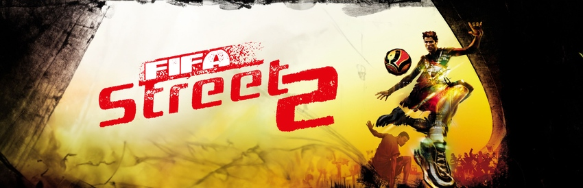

<p align="center"></p>

<h1 align="center">street2-nx</h1>

<p align="center">
  <b>FIFA Street 2</b> (Xbox, 2006) on the <b>Nintendo Switch</b>,<br>
  statically recompiled from the original Xbox executable — no emulator.
</p>

The game's x86 code is translated to C++ and built as a native Switch program. A runtime stands in for the Xbox
kernel, its Direct3D 8 (drawn with **deko3d**, the Switch's own graphics API, or with Vulkan/NVK) and its audio.
street2-nx is built on **[street-nx](https://github.com/xsaja/street-nx)**, the FIFA Street port, which is built on **[mvp-nx](https://github.com/xsaja/mvp-nx)**, the MVP Baseball 2005 port, which starts from
TGP482's **[XboxXBE-Recomp](https://github.com/TGP482/XboxXBE-Recomp)**, maddog847's
**[MVP05 XBE Recomp](https://github.com/maddog847/MVP-Baseball-2005-XBERecomp)** and the Switch layer of
**[BLACK-NX-PORT](https://github.com/gerisson1996/BLACK-NX-PORT)**.

> [!NOTE]
> You need your own copy of *FIFA Street 2* for the original Xbox, **USA** release (title ID `45410085`): the disc
> image (`.iso`) or the extracted disc (the folder with `default.xbe`). No game files are in this repository, and none
> are distributed.

## What works

Tested on a Switch (Atmosphère, title mode), handheld (1280x720):

- Boot, the EA logos, the intro movies, the menus and every mode: Play Now, Game Modes, Create a Zone, Rewards,
  Options, Radio Stations, Rule the Street, Skill Challenges
- Matches at **60 fps**, with the Gamebreaker and the replays
- The game's language follows the Switch's system language

## Installation

> [!TIP]
> **Installer page: [xsaja.github.io/street2-nx](https://xsaja.github.io/street2-nx/)** (once it is published). Pick your
> disc image or game folder, get `street2-nx.zip`, extract it into `sdmc:/switch/`. Everything runs in your browser: your
> game files are never uploaded.

By hand:

1. Copy the `street2-nx` folder of the package to `SD:/switch/street2-nx/` (`street2.nro`, `street2-settings.toml`,
   `LICENSES.txt`).
2. Copy the files of your disc to `SD:/switch/street2-nx/game/`: `default.xbe` and the `data` folder (about 1.9 GB).
3. Start it in **title mode** (hold R while starting a game and pick it in hbmenu, or use sphaira or a forwarder). Applet
   mode (the album) does not have enough memory and says so.

The first start compiles the deko3d shaders (a few seconds of black screen); they are kept in `shadercache/`.

## Controls

| Switch | Xbox |
|---|---|
| B / A / Y / X | A / B / X / Y (by position: the button the game shows sits where you press) |
| L / R | left / right trigger |
| ZL / ZR | white / black |
| + / − | Start / Back |
| sticks, stick clicks | sticks, stick clicks |

`buttons_by_name = true` in the settings maps A/B/X/Y by letter instead.

## Settings

`street2-settings.toml` beside the NRO, commented. The ones a player may want:

- `language`: `"auto"` (the Switch's) or a language code.
- `anisotropic_filtering`: 4 by default; 8 or 16 sharpen the ground further, 2 is cheaper.
- `smaa`: SMAA anti-aliasing, off by default (it costs GPU time; docked it may drop frames).
- `frame_pacing`: `"vsync"` by default (the screen paces the game); `"timer"` as older builds.
- `renderer`: `"deko3d"` (default) or `"vulkan"`.
- `cpu_mhz`, `gpu_mhz`, `mem_mhz`: 0 = the console's clocks. FIFA Street 2 does not need more.

Logs go to `SD:/switch/street2-nx/logs/`.

## Building

Windows, with Visual Studio 2026 (its Clang), CMake and Python for the PC builds, and devkitPro (MSYS2, `switch-dev`,
deko3d, uam) for the Switch. Put the disc's files in `game/assets` (or a junction to them).

```
tools\build_pc.cmd                      # STREET2-d3d12.exe, STREET2-vk.exe; recompiles default.xbe into game/generated
switch/build.sh                         # in MSYS2: build-switch/street2.nro (VERBOSE=ON for a full log)
PGO=generate switch/build.sh            # instrumented build; then tools/pgo_merge.ps1 and PGO=use (see docs/technical-notes.md)
```

The first PC build writes `game/config/game.toml` with `xbe_symbols`; its `[symbols]` section also names the XDK
functions the game calls that `xbe_symbols` missed (see `docs/technical-notes.md`). `nvk_sdk/` is the Mesa 26.2.4
Horizon build (NVK) the Vulkan renderer links.

The installer page is `installer/`, adapted from mvp-nx's (itself from defjam-sw-installer and nfsmw-nx-installer).
`.github/workflows/pages.yml` publishes it with the `street2.nro` of a release, checked against
`installer/release/manifest.json`. To try it locally, put `street2.nro`, `street2-settings.toml` and `LICENSES.txt` in
`installer/release/` and run `python installer/serve.py 8195 installer`.

## Credits

- **TGP482**: XboxXBE-Recomp, the recompiler and the runtime
- **maddog847**: MVP05 XBE Recomp, whose SDK fixes mvp-nx, street-nx and street2-nx carry
- **gerisson1996**: BLACK-NX-PORT, the Switch layer
- **xsaja**: mvp-nx, street-nx and street2-nx
- **ChanseyIsTheBest**: the deko3d guide of sa2-nx, uam as a library, the Ryujinx fork used for testing
- **fincs**: deko3d and uam; **danfromtico**, **NaGaa95**: mesa-switch and its 26.2.4 build
- **R-drg**: defjam-sw, whose profiler the Switch profiler is adapted from
- **Jorge Jimenez et al.**: SMAA
- Banner, logo and NRO icon: community art from **[SteamGridDB](https://www.steamgriddb.com/)**

Every license is in `LICENSES.txt`.

## Legal

FIFA Street 2 is a trademark of Electronic Arts. This project has no relation to Electronic Arts, FIFA or Nintendo. It
contains no game data; `street2.nro` contains code translated from the player's own `default.xbe`. The code of street2-nx
is licensed under the GNU General Public License version 3 (`LICENSE`), as mvp-nx's and street-nx's are.
